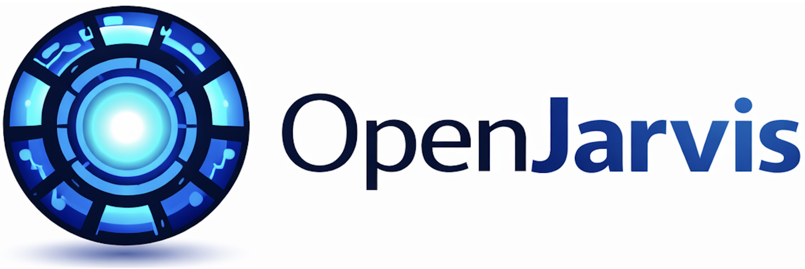
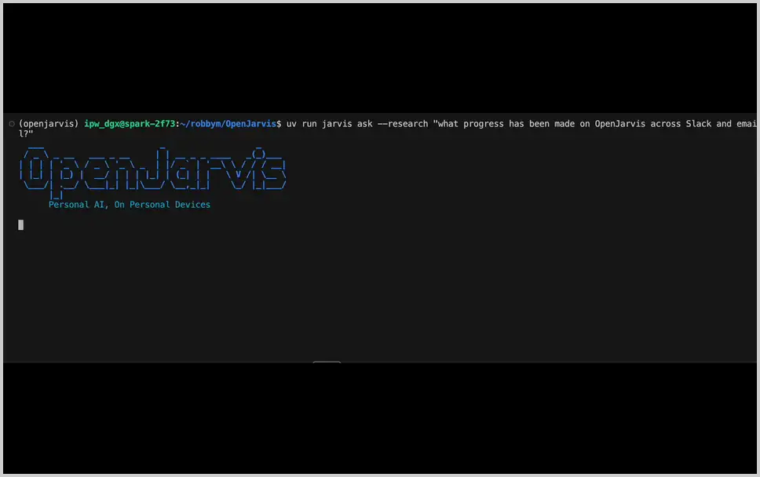

<div align="center">
  

  <p><i>Personal AI, On Personal Devices.</i></p>

  <p>
    <a href="https://arxiv.org/abs/2605.17172"></a>
    <a href="https://openjarvis.stanford.edu/"></a>
    <a href="https://open-jarvis.github.io/OpenJarvis/"></a>
    
    
    <a href="https://discord.gg/CMVBmDQ5Fj"></a>
    <a href="https://x.com/OpenJarvisAI"></a>
  </p>
</div>

---

<div align="center">
  
</div>

---

> **[Documentation](https://open-jarvis.github.io/OpenJarvis/)**
>
> **[Project Site](https://openjarvis.stanford.edu/)**
>
> **[Paper](https://arxiv.org/abs/2605.17172)**
>
> **[Leaderboard](https://open-jarvis.github.io/OpenJarvis/leaderboard/)**
>
> **[Roadmap](https://open-jarvis.github.io/OpenJarvis/development/roadmap/)**

## Why Tavro?

Personal AI agents are exploding in popularity, but nearly all of them still route intelligence through cloud APIs. Your "personal" AI continues to depend on someone else's server. At the same time, our [Intelligence Per Watt](https://www.intelligence-per-watt.ai/) research showed that local language models already handle 88.7% of single-turn chat and reasoning queries, with intelligence efficiency improving 5.3× from 2023 to 2025. The models and hardware are increasingly ready. What has been missing is the software stack to make local-first personal AI practical.

Tavro is that stack. It is a framework for local-first personal AI, built around three core ideas: shared primitives for building on-device agents; evaluations that treat energy, FLOPs, latency, and dollar cost as first-class constraints alongside accuracy; and a learning loop that improves models using local trace data. The goal is simple: make it possible to build personal AI agents that run locally by default, calling the cloud only when truly necessary. Tavro aims to be both a research platform and a production foundation for local AI, in the spirit of PyTorch.

## Architecture & Tech Stack

Tavro is designed as a modular, local-first intelligence framework:

```
┌─────────────────────────────────────────────────────────────┐
│                      Tavro Client UI                        │
│          React 19 · Vite · TailwindCSS · Zustand            │
│         (Port 5173 / Tauri v2 Desktop Webview)              │
└──────────────────────────────┬──────────────────────────────┘
                               │ HTTP / WebSocket Proxy
┌──────────────────────────────▼──────────────────────────────┐
│                   Tavro Core API Server                     │
│               FastAPI · Uvicorn (Port 8000)                 │
├──────────────────────────────┬──────────────────────────────┤
│  Agent & Tool Orchestration  │  Multi-Engine Abstraction    │
│  · Simple & ReAct            │  · Local Ollama (Port 11434) │
│  · CodeAct / OpenHands       │  · vLLM / LM Studio / AFM    │
│  · Deep Research & Memory    │  · Hosted Cloud (NIM, etc.)  │
└──────────────────────────────┴──────────────────────────────┘
```

- **Backend Runtime:** Python 3.10–3.12 (CPython), FastAPI, Starlette, Uvicorn, Pydantic v2, HTTPX, Maturin.
- **Frontend App:** TypeScript, React 19, Vite, TailwindCSS v4, Motion, Lucide Icons, KaTeX, Zustand.
- **Native Extension:** Rust (Maturin / PyO3) for high-performance memory vector indexing and token bucket rate-limiting.
- **Local Inference:** Native Ollama runtime (`llamacpp`), supporting Qwen 3.5, Llama 3, DeepSeek, and custom GGUF models.

---

## Features Implemented

- **Local-First & Multi-Engine Inference:** Direct integration with Ollama and external endpoints. Automatic fallback, unwrapping, and dynamic model pulling (`/v1/models/pull`) via `MultiEngine`.
- **OpenAI-Compatible Server:** Full `/v1/chat/completions`, `/v1/models`, `/v1/info`, and streaming SSE token generation.
- **Autonomous Agents:** Eight built-in agents including ReAct, CodeAct, deep research planner, and daily morning briefings.
- **Tool Ecosystem:** Agent skills, web search, MCP server bridge, shell and code execution in isolated environments.
- **Memory & Knowledge Retrieval:** Vector and keyword memory interfaces (SQLite, BM25, ColBERT, FAISS) with graceful fallback reporting and configurable retry polling.
- **Cross-Platform UI:** Full-featured modern web application and Tauri v2 desktop integration with dark mode, markdown math rendering, and offline PWA support.

---

## Project Structure

```
tavro-main/
├── assets/                  # Branding, icons, reels, and screenshots
├── configs/                 # Default and preset YAML/TOML configuration templates
├── deploy/                  # Dockerfiles, docker-compose, and cloud deploy configs
├── desktop/                 # Desktop integration packaging
├── docs/                    # Extensive user guides, tutorials, and architecture specs
├── frontend/                # React 19 + TypeScript frontend application
│   ├── src/                 # Components, stores, hooks, pages, and API clients
│   └── package.json         # NPM package manifest
├── rust/                    # Native Rust crates (tavro-python PyO3 bindings)
├── src/tavro/               # Core Python package
│   ├── agents/              # Autonomous agent architectures (ReAct, CodeAct)
│   ├── cli/                 # Command-line interface commands (serve, doctor, pull)
│   ├── core/                # Core configuration, state, and bus primitives
│   ├── engine/              # Engine providers (Ollama, NIM, AFM, MultiEngine)
│   ├── memory/              # Memory subsystems and vector stores
│   ├── security/            # Capability policy, rate limiters, guardrails
│   ├── server/              # FastAPI server routes, middleware, and bridges
│   └── tools/               # Tool catalog and agent integrations
├── tests/                   # Pytest backend test suite (unit and integration)
├── pyproject.toml           # Project dependencies and packaging metadata
└── uv.lock                  # Pinned transitive dependency lockfile
```

---

## Windows 11 ARM64 Compatibility Notes

Tavro is validated for Windows 11 on ARM64 processors (such as Qualcomm Snapdragon X):

1. **Python Interpreter Selection:**
   - Use an **x64 CPython 3.12 interpreter** running under Windows x64 emulation (e.g. at `venv\runtime\Scripts\python.exe`). This ensures pre-built x86_64 wheels (such as `pyarrow`, `numpy`, `ctranslate2`, and `scipy`) install and run seamlessly without requiring local CMake/C++ toolchains on ARM64.
2. **Ollama Inference:**
   - Run the native **Windows ARM64 Ollama runtime** (`0.40.16` or later), located at `%LOCALAPPDATA%\Programs\Ollama\ollama.exe`. It natively utilizes Snapdragon X CPU and Hexagon NPU/GPU acceleration.
3. **Application Control (WDAC / AppLocker) Policies:**
   - On managed Windows devices with strict Code Integrity or AppLocker policies, unsigned executable build scripts (e.g. Cargo's `build_script_build.exe` or ARM64 compiler driver DLLs) in user directories may trigger OS error 4551 (`0xC0E90002`). Tavro gracefully falls back to structured diagnostics and informational 503 states.
4. **Vite Production Bundler:**
   - Vite is configured with `@rollup/wasm-node` fallback so service-worker generation succeeds in production builds without requiring unsigned native `.node` binaries.

---

## Configuration Requirements

Tavro can be configured via `config.toml` or command-line flags passed to `tavro serve`:

| Option | CLI Flag | Default | Description |
|---|---|---|---|
| Host | `--host` | `127.0.0.1` | Bind address for the API server |
| Port | `--port` | `8000` | Port for the FastAPI server |
| Engine | `-e`, `--engine` | `ollama` | Selected inference engine (`ollama`, `multi`, `nim`, etc.) |
| Model | `-m`, `--model` | `qwen3.5:4b` | Default served model tag |
| Agent | `-a`, `--agent` | `orchestrator` | Default chat agent (`simple`, `orchestrator`, `react`) |

---

## Running the Application

### 1. Start Local Ollama
```powershell
ollama serve
# Verify running:
curl http://127.0.0.1:11434/api/tags
```

### 2. Start the Backend API Server
```powershell
# Using the serving virtual environment:
.\venv\runtime\Scripts\python.exe -m tavro.cli serve --host 127.0.0.1 --port 8000 --engine ollama --model qwen3.5:4b
```

### 3. Start the Frontend UI
```powershell
cd frontend
npm install
npm run dev -- --host 127.0.0.1 --port 5173
```
Open your browser at **http://127.0.0.1:5173**.

---

## Known Limitations

- **Native SQLite Memory Extension:** Compiling `tavro_rust` requires Rust 1.89+ with the `x86_64-pc-windows-msvc` target. If Windows AppLocker or WDAC blocks unsigned user-space build scripts, memory stats report HTTP 503 with administrator action instructions.
- **Model Pulling:** Model downloading requires a reachable, healthy local Ollama instance; cloud and hosted endpoints do not support model downloads.

---

## Installation

Pick your platform and run one command. Each installer handles [uv](https://docs.astral.sh/uv/), the Python venv, Ollama, and a starter model — about 3 minutes on broadband.

| Platform | One-liner |
|---|---|
| **macOS · Linux · WSL2** | `curl -fsSL https://open-jarvis.github.io/OpenJarvis/install.sh \| bash` |
| **Native Windows** | `irm https://open-jarvis.github.io/OpenJarvis/install.ps1 \| iex` |
| **Desktop GUI** | Download `.exe` / `.dmg` / `.deb` / `.rpm` / `.AppImage` from the [latest release](https://github.com/open-jarvis/OpenJarvis/releases) |

Then `tavro` to start. The Rust extension and larger models continue downloading in the background; `tavro doctor` shows status.

Platform-specific notes (WSL2 setup, native-Windows scheduled-task service, desktop prerequisites, manual / contributor install): see the [installation docs](https://open-jarvis.github.io/OpenJarvis/getting-started/install/).

## Quick Start

```bash
tavro                          # start chatting (default: chat-simple)
tavro gui                      # start the graphical browser interface
tavro init --preset <name> --force  # replace config with a starter preset
```

`tavro gui` starts the local API server and frontend, then opens the graphical
chat interface in your default browser. It requires Node.js 22+ and is
available from a source checkout; packaged desktop installers are available
from the [latest release](https://github.com/open-jarvis/OpenJarvis/releases).

> Prefix `tavro ...` with `uv run`, or `source .venv/bin/activate` first.

| Preset | What it does |
|---|---|
| `morning-digest-mac` / `morning-digest-linux` / `morning-digest-minimal` | Spoken daily briefing from email, calendar, health, news |
| `deep-research` | Multi-hop research across indexed docs with citations |
| `code-assistant` | Agent with code execution, file I/O, and shell access |
| `scheduled-monitor` | Stateful agent on a schedule with memory |
| `chat-simple` | Lightweight conversation, no tools |

Example:

```bash
tavro init --preset morning-digest-mac --force
tavro connect gdrive          # one OAuth covers Gmail / Calendar / Tasks
tavro digest --fresh          # generate and play your first briefing
```

Per-preset deep dives: [morning digest](https://open-jarvis.github.io/OpenJarvis/user-guide/morning-digest/) · [deep research](https://open-jarvis.github.io/OpenJarvis/user-guide/deep-research/) · [code assistant](https://open-jarvis.github.io/OpenJarvis/user-guide/code-assistant/) · [scheduled monitor](https://open-jarvis.github.io/OpenJarvis/user-guide/scheduled-monitor/) · [chat simple](https://open-jarvis.github.io/OpenJarvis/user-guide/chat-simple/) · or the full [quickstart guide](https://open-jarvis.github.io/OpenJarvis/getting-started/quickstart/).

### Skills

Skills teach agents how to better use tools and improve their reasoning. Every skill is a tool — agents discover them from a catalog and invoke them on demand.

```bash
# Install skills from public sources
tavro skill install hermes:arxiv
tavro skill sync hermes --category research

# Use skills with any agent
tavro ask "Use the code-explainer skill to explain this Python code: for i in range(5): print(i*2)"

# Optimize skills from your trace history
tavro optimize skills --policy dspy

# Benchmark the impact
tavro bench skills --max-samples 5 --seeds 42
```

Import from [Hermes Agent](https://github.com/NousResearch/hermes-agent) (~150 skills), [OpenClaw](https://github.com/openclaw/skills) (~13,700 community skills), or any GitHub repo. Skills follow the [agentskills.io](https://agentskills.io/specification) open standard.

See the [Skills User Guide](https://open-jarvis.github.io/OpenJarvis/user-guide/skills/) and [Skills Tutorial](https://open-jarvis.github.io/OpenJarvis/tutorials/skills-workflow/) for details.

### Built-in Agents

Tavro ships with eight built-in agents across three execution modes (on-demand, scheduled, continuous):

| Agent | Type | What it does |
|-------|------|-------------|
| `morning_digest` | Scheduled | Daily briefing from email, calendar, health, news — with TTS audio |
| `deep_research` | On-demand | Multi-hop research with citations across web and local docs |
| `monitor_operative` | Continuous | Long-horizon monitoring with memory, compression, and retrieval |
| `orchestrator` | On-demand | Multi-turn reasoning with automatic tool selection |
| `native_react` | On-demand | ReAct (Thought-Action-Observation) loop agent |
| `operative` | Continuous | Persistent autonomous agent with state management |
| `native_openhands` | On-demand | CodeAct — generates and executes Python code |
| `simple` | On-demand | Single-turn chat, no tools |

See the [User Guide](https://open-jarvis.github.io/OpenJarvis/user-guide/morning-digest/) and [Tutorials](https://open-jarvis.github.io/OpenJarvis/tutorials/) for detailed setup instructions.

Full documentation — including Docker deployment, cloud engines, development setup, and tutorials — at **[tavro.github.io/Tavro](https://open-jarvis.github.io/OpenJarvis/)**.

## Community

- **GitHub:** [github.com/tavro/Tavro](https://github.com/open-jarvis/OpenJarvis)
- **Discord:** [discord.gg/CMVBmDQ5Fj](https://discord.gg/CMVBmDQ5Fj)
- **X / Twitter:** [@TavroAI](https://x.com/OpenJarvisAI)
- **Docs:** [tavro.github.io/Tavro](https://open-jarvis.github.io/OpenJarvis/)

## Contributing

We welcome contributions! See the [Contributing Guide](CONTRIBUTING.md) for incentives, contribution types, and the PR process.

Quick start for contributors:

```bash
git clone https://github.com/open-jarvis/OpenJarvis.git
cd Tavro
uv sync --extra dev
uv run pre-commit install
uv run pytest tests/ -v
```

Browse the [Roadmap](https://open-jarvis.github.io/OpenJarvis/development/roadmap/) for areas where help is needed. Comment **"take"** on any issue to get auto-assigned.

## About

Tavro is part of [Intelligence Per Watt](https://www.intelligence-per-watt.ai/), a research initiative studying the intelligence efficiency of AI systems. The project is developed at [Hazy Research](https://hazyresearch.stanford.edu/) and the [Scaling Intelligence Lab](https://scalingintelligence.stanford.edu/) at [Stanford SAIL](https://ai.stanford.edu/).

## Sponsors

<p>
  <a href="https://www.laude.org/">Laude Institute</a> &bull;
  <a href="https://datascience.stanford.edu/marlowe">Stanford Marlowe</a> &bull;
  <a href="https://cloud.google.com/">Google Cloud Platform</a> &bull;
  <a href="https://lambda.ai/">Lambda Labs</a> &bull;
  <a href="https://ollama.com/">Ollama</a> &bull;
  <a href="https://research.ibm.com/">IBM Research</a> &bull;
  <a href="https://hai.stanford.edu/">Stanford HAI</a>
</p>

## Citation
```bibtex
@misc{saadfalcon2026tavropersonalaipersonal,
      title={Tavro: Personal AI, On Personal Devices}, 
      author={Jon Saad-Falcon and Avanika Narayan and Robby Manihani and Tanvir Bhathal and Herumb Shandilya and Hakki Orhun Akengin and Gabriel Bo and Andrew Park and Matthew Hart and Caia Costello and Chuan Li and Christopher Ré and Azalia Mirhoseini},
      year={2026},
      eprint={2605.17172},
      archivePrefix={arXiv},
      primaryClass={cs.LG},
      url={https://arxiv.org/abs/2605.17172}, 
}
```

## License

[Apache 2.0](LICENSE)
